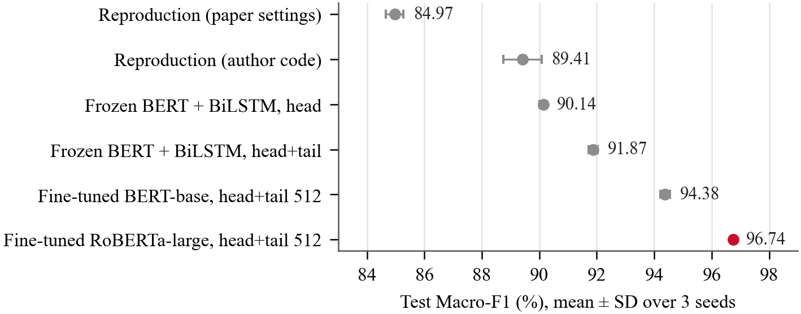

<!-- Ghi chú nội bộ: trên máy làm việc, đọc GHI_NHO.md trước khi làm việc và cập nhật cuối mỗi phiên (file này không được đưa lên GitHub). -->

# imdb-sentiment-revisited: Phân loại cảm xúc review phim IMDb

Tái lập phương pháp **BERT + BiLSTM** của Nkhata *et al.* (2023) trên một cách chia dữ liệu IMDb sạch (giữ nguyên tập test chính thức), sau đó cải tiến bằng cách **giữ đầu và cuối review** và **fine-tune toàn bộ encoder**. Kết quả tốt nhất: **RoBERTa-large, Macro-F1 96,74% ± 0,04** trên 25.000 review test, cao hơn bản tái lập 7,33 điểm. Mức chênh này có ý nghĩa thống kê.

**Nhóm thực hiện:** Trường Đại học FPT, thành phố Đà Nẵng, Việt Nam

| Họ và tên | MSSV |
|---|---|
| Vũ Quốc Đạt | DE200522 |
| Nguyễn Gia Phúc | DE200407 |
| Ngô Ngọc Trường Sơn | DE200399 |

---

## Mục lục

1. [Kết quả chính](#1-kết-quả-chính)
2. [Cấu trúc thư mục](#2-cấu-trúc-thư-mục)
3. [Yêu cầu hệ thống](#3-yêu-cầu-hệ-thống)
4. [Cài đặt](#4-cài-đặt)
5. [Chuẩn bị dữ liệu và mô hình](#5-chuẩn-bị-dữ-liệu-và-mô-hình)
6. [Chạy lại các thí nghiệm](#6-chạy-lại-các-thí-nghiệm)
7. [Kiểm định thống kê, hình và bài báo](#7-kiểm-định-thống-kê-hình-và-bài-báo)
8. [Kiểm thử](#8-kiểm-thử)
9. [Báo cáo và tài liệu](#9-báo-cáo-và-tài-liệu)
10. [Thí nghiệm phụ](#10-thí-nghiệm-phụ)
11. [Nguồn, trích dẫn và license](#11-nguồn-trích-dẫn-và-license)

---

## 1. Kết quả chính

Macro-F1 trên **25.000 review test chính thức** của IMDb, trung bình ± độ lệch chuẩn qua 3 seed (42, 43, 44):

| Cấu hình | Số token | Macro-F1 (%) |
|---|---:|---:|
| Tái lập bài báo, theo mô tả trong bài (BERT đóng băng + BiLSTM) | 128 | 84,97 ± 0,30 |
| Tái lập bài báo, theo mã tác giả (BERT đóng băng + BiLSTM) | 256 | 89,41 ± 0,67 |
| BERT đóng băng + mean pooling | 256 | 85,71 ± 0,04 |
| BERT đóng băng + BiLSTM, lấy phần đầu | 256 | 90,14 ± 0,13 |
| BERT đóng băng + BiLSTM, lấy đầu + cuối | 256 | 91,87 ± 0,17 |
| Fine-tune BERT-base, đầu 128 + cuối 382 | 512 | 94,38 ± 0,17 |
| **Fine-tune RoBERTa-large, đầu 128 + cuối 382** | **512** | **96,74 ± 0,04** |



**Ba ý chính:**

- **Không so trực tiếp với con số 97,67% của bài báo.** Bài báo đo trên cách chia lại sau khi gộp train và test. Repo này giữ nguyên tập test chính thức.
- **Điểm yếu lớn nhất của cách làm gốc là cắt mất phần cuối review.** Khi giới hạn 256 token, 40% review test bị cắt. Chỉ cần giữ cả phần đầu lẫn phần cuối, nhóm review bị cắt tăng từ 86,7% lên 90,3%.
- **Mọi cải tiến đều có ý nghĩa thống kê.** Kiểm định bằng bootstrap ghép cặp theo 3.581 phim (10.000 lần lấy mẫu, hiệu chỉnh Holm) và McNemar cho từng seed; xem `reports/significance_tests.json`.

---

## 2. Cấu trúc thư mục

```
imdb-sentiment-revisited/
├── configs/                 Cấu hình JSON cho từng thí nghiệm (siêu tham số, seed, đường dẫn)
├── scripts/                 Mã Python
│   ├── prepare_full_imdb.py       Bước 1: tạo split sạch từ aclImdb_v1.tar.gz
│   ├── train_reproduction.py      Bước 2: tái lập BERT + BiLSTM (biến thể "code" và "paper")
│   ├── train_baselines.py         Bước 3: baseline BERT đóng băng (mean pooling, BiLSTM đầu, BiLSTM đầu–cuối)
│   ├── train_finetune_headtail.py Bước 4: fine-tune BERT-base / RoBERTa-large với đầu–cuối 512
│   ├── significance_tests.py      Bước 5: bootstrap theo phim + McNemar
│   ├── runtime_io.py              Tiện ích ghi file trạng thái an toàn (dùng chung)
│   ├── analyze_validation.py, build_analysis_report.py, phase2_core.py   Phân tích lỗi trên validation
│   ├── demo_server.py, check_demo.py                                     Demo web so sánh hai mô hình
│   ├── train_multichunk.py, train_chunk_compare.py, chunk_attention_model.py, evaluate_chunk_compare.py
│   │                              Thí nghiệm phụ: đọc review dài theo nhiều đoạn (xem mục 10)
│   ├── diagnostics/               Công cụ chẩn đoán lỗi CUDA (chỉ đọc, không sửa checkpoint)
│   ├── tests/                     Unit test chạy trên CPU
│   └── translate_en_vi.py         Dịch review sang tiếng Việt bằng NLLB (thí nghiệm phụ)
├── run/                     File .cmd chạy nhanh trên Windows (bấm đúp hoặc gọi từ terminal)
├── reports/                 Kết quả, báo cáo, hình
│   ├── ieee_paper/                Bài báo IEEE (LaTeX + PDF + script vẽ hình)
│   ├── presentation_charts/       Biểu đồ dùng trong slide thuyết trình
│   ├── improvement_report/        Số liệu tổng hợp (report_data.json) và hình của báo cáo Word
│   ├── validation_analysis/       Phân tích 100 trường hợp trên tập validation
│   └── significance_tests.json    Kết quả kiểm định thống kê
├── docs/                    Hướng dẫn dữ liệu, ghi chú đối chiếu mã tác giả, kế hoạch thí nghiệm
├── demo/                    Giao diện web của demo
├── requirements-*.txt       Thư viện cần cài
├── THIRD_PARTY_NOTICES.md   Nguồn gốc và license của dữ liệu, mô hình, mã bên thứ ba
└── LICENSE                  MIT (chỉ áp dụng cho mã của nhóm)
```

Các thư mục **không có trên GitHub** vì nặng hoặc chịu license bên thứ ba: `data/`, `checkpoints/`, `work_dirs/` (checkpoint và kết quả từng lượt chạy), `logs/`, `third_party/` (mã tác giả gốc). Bạn tự tạo chúng theo mục 5.

---

## 3. Yêu cầu hệ thống

| Thành phần | Đã dùng khi chạy thí nghiệm |
|---|---|
| Hệ điều hành | Windows 11 (các lệnh Python cũng chạy được trên Linux) |
| GPU | NVIDIA RTX 5070 Laptop, 8 GB VRAM, CUDA 12.8 |
| Python | 3.10 trở lên |
| Thư viện chính | PyTorch 2.7.1, Transformers 4.51.3, scikit-learn 1.6.1, NumPy 1.26.4 |
| Dung lượng trống | Khoảng 25 GB (dữ liệu, 2 mô hình, checkpoint của 3 seed) |

Fine-tune RoBERTa-large dùng gần hết 8 GB VRAM (đỉnh khoảng 6,3 GB do PyTorch cấp phát). Khi chạy, hãy tắt các ứng dụng khác đang dùng GPU.

---

## 4. Cài đặt

Các lệnh dưới đây chạy trong PowerShell hoặc Command Prompt, từ thư mục gốc của repo.

```bash
git clone https://github.com/sotbatchien123/imdb-sentiment-revisited.git
cd imdb-sentiment-revisited

python -m venv .venv-train
.venv-train\Scripts\python -m pip install --upgrade pip
.venv-train\Scripts\python -m pip install torch==2.7.1 --index-url https://download.pytorch.org/whl/cu128
.venv-train\Scripts\python -m pip install -r requirements-train.txt
```

Muốn cài đúng từng phiên bản đã dùng khi chạy thí nghiệm thì dùng `requirements-train.lock.txt` thay cho `requirements-train.txt`.

Kiểm tra PyTorch đã nhận GPU:

```bash
.venv-train\Scripts\python -c "import torch; print(torch.__version__, torch.cuda.is_available())"
```

Để vẽ hình (mục 7), cài thêm matplotlib: `.venv-train\Scripts\python -m pip install matplotlib`.

---

## 5. Chuẩn bị dữ liệu và mô hình

### 5.1. Dữ liệu IMDb

1. Tải `aclImdb_v1.tar.gz` từ https://ai.stanford.edu/~amaas/data/sentiment/
2. Đặt file vào `data/raw/aclImdb_v1.tar.gz` (không cần giải nén).
3. Tạo split sạch:

```bash
.venv-train\Scripts\python scripts\prepare_full_imdb.py
```

Script đọc thẳng file nén, rồi:
- loại 223 review train bị trùng lặp hoặc trùng với tập test;
- chia phần train còn lại **theo phim** thành 21.027 review train và 3.750 review validation;
- giữ nguyên 25.000 review test.

Kết quả nằm ở `data/processed/imdb_full_v1/`. File `manifest.json` trong đó ghi mã SHA-256 của file nguồn và từng review đã bị loại.

### 5.2. Mô hình tiền huấn luyện

Các script đọc mô hình từ thư mục `checkpoints/` ở chế độ offline. Tải một lần:

```bash
.venv-train\Scripts\huggingface-cli download google-bert/bert-base-uncased --local-dir checkpoints/bert-base-uncased
.venv-train\Scripts\huggingface-cli download FacebookAI/roberta-large --local-dir checkpoints/roberta-large
```

---

## 6. Chạy lại các thí nghiệm

Mỗi script huấn luyện đọc cấu hình từ `configs/`, chạy lần lượt 3 seed, và ghi tiến độ vào `work_dirs/<tên thí nghiệm>/seed<N>/status.json`. Nếu bị ngắt, chạy lại đúng lệnh đó thì script sẽ tiếp tục từ checkpoint gần nhất. Mọi script huấn luyện đều có tùy chọn `--smoke` để chạy thử nhanh trên vài mẫu trước khi chạy thật.

| Bước | Lệnh | Cấu hình | Thời gian (tham khảo, 1 GPU 8 GB) |
|---|---|---|---|
| Tái lập bài báo | `.venv-train\Scripts\python scripts\train_reproduction.py` | `configs/reproduction_v1.json` | ~20–30 phút / seed / biến thể |
| Baseline BERT đóng băng | `.venv-train\Scripts\python scripts\train_baselines.py --config configs/full_imdb.json` | `configs/full_imdb.json` | 1–8 giờ / lượt (50 epoch) |
| Fine-tune BERT-base | `.venv-train\Scripts\python scripts\train_finetune_headtail.py` | `configs/finetune_headtail_v1.json` | ~20–40 phút / seed |
| Fine-tune RoBERTa-large | `.venv-train\Scripts\python scripts\train_finetune_headtail.py --config configs\finetune_roberta_large_v1.json` | `configs/finetune_roberta_large_v1.json` | ~1–1,5 giờ / seed |

Một số tùy chọn hữu ích:
- `train_reproduction.py --variant code --seed 42`: chỉ chạy một biến thể và một seed.
- `train_finetune_headtail.py --seed 43`: chỉ chạy một seed.
- Tạm dừng an toàn: tạo một file rỗng tên `PAUSE` trong thư mục `work_dirs/<tên thí nghiệm>/`. Script sẽ dừng sau khi lưu xong epoch đang chạy.

Trên Windows có thể dùng các file trong thư mục `run/`, ví dụ `run\run-finetune-roberta-large.cmd`.

Quy tắc đánh giá, áp dụng cho mọi thí nghiệm:
- Epoch tốt nhất được chọn theo Macro-F1 trên **validation**.
- Tập **test** chỉ được đánh giá một lần cho mỗi lượt chạy.
- Không dò siêu tham số hay ngưỡng trên tập test.

---

## 7. Kiểm định thống kê, hình và bài báo

```bash
# Kiểm định (chỉ dùng CPU, khoảng 30 giây, cần kết quả của mục 6 trong work_dirs/)
.venv-train\Scripts\python scripts\significance_tests.py

# Hình cho bài báo IEEE và biểu đồ thuyết trình (đọc reports/improvement_report/report_data.json)
.venv-train\Scripts\python reports\ieee_paper\make_figures.py
.venv-train\Scripts\python reports\presentation_charts\make_charts.py . reports\presentation_charts
```

Bài báo IEEE nằm ở `reports/ieee_paper/main.tex`, bản đã biên dịch là `main.pdf`. Cách biên dịch lại: `tectonic main.tex`, hoặc tải lên Overleaf và chọn compiler **XeLaTeX** để tên tiếng Việt hiển thị đúng. Chi tiết xem `reports/ieee_paper/README.md`.

---

## 8. Kiểm thử

```bash
.venv-train\Scripts\python -m unittest discover -s scripts\tests -v
```

17 test chạy trên CPU trong khoảng 5 giây. Các test kiểm tra:
- cách cắt đầu–cuối giữ đúng hai đầu review;
- việc ghi file trạng thái không làm dừng huấn luyện khi file đang bị khoá;
- mô-đun gộp nhiều đoạn: hình dạng tensor, cửa sổ tích lũy gradient, khôi phục trạng thái;
- tính toàn vẹn của split dữ liệu (test này cần có `data/processed/`).

---

## 9. Báo cáo và tài liệu

| File | Nội dung |
|---|---|
| `reports/ieee_paper/main.pdf` | Bài báo IEEE (tiếng Anh, 6 trang) |
| `reports/BAO_CAO_CAI_TIEN_2026-11-01.docx` | Báo cáo chi tiết bằng tiếng Việt |
| `reports/significance_tests.json` | Kiểm định thống kê cho 8 phép so sánh |
| `reports/full_imdb_report.md` | Kết quả từng lượt của các baseline BERT đóng băng |
| `reports/validation_analysis/report.md` | Phân tích 100 trường hợp lỗi trên tập validation |
| `docs/code_audit.md` | Đối chiếu mã tác giả với mô tả trong bài báo |
| `docs/dataset.md` | Hướng dẫn tải dữ liệu |

---

## 10. Thí nghiệm phụ

Các phần dưới đây là thí nghiệm khám phá. Chúng **không** dùng cho kết quả chính, nhưng được giữ lại để minh bạch quá trình làm:

| Thí nghiệm | Mã / tài liệu | Trạng thái |
|---|---|---|
| Baseline trên tập con phim Horror (giai đoạn đầu) | `configs/baseline.json`, `scripts/prepare_horror.py`, `docs/baseline_run.md` | Đã dừng, chuyển sang toàn bộ IMDb |
| Đọc review dài theo nhiều đoạn (BiLSTM dùng chung, gộp trung bình) | `scripts/train_multichunk.py`, `docs/phase2.md` | Dừng ở epoch 5/50 do lỗi driver GPU |
| Gộp các đoạn bằng attention | `scripts/train_chunk_compare.py`, `docs/chunk_compare_run.md` | Đã có mã và unit test, chưa chạy trên GPU |
| Chẩn đoán lỗi CUDA | `scripts/diagnostics/` | Chạy lại đoạn bị lỗi trên 4.000 batch, không tái hiện được lỗi |
| Dịch review sang tiếng Việt (NLLB) | `scripts/translate_en_vi.py`, `run/setup-translation.cmd` | Đã có công cụ, chưa dịch tập dữ liệu |

---

## 11. Nguồn, trích dẫn và license

- **Bài báo tái lập:** G. Nkhata, S. Gauch, U. Anjum, J. Zhan, *Fine-tuning BERT with Bidirectional LSTM for Fine-grained Movie Reviews Sentiment Analysis*, Int. J. Advances in Systems and Measurements, 2023 (arXiv:2502.20682).
- **Dữ liệu:** A. L. Maas *et al.*, *Learning Word Vectors for Sentiment Analysis*, ACL 2011.
- **Mô hình:** `google-bert/bert-base-uncased` (Apache-2.0), `FacebookAI/roberta-large` (MIT).

Mã do nhóm viết trong repo này phát hành theo giấy phép **MIT** (xem [LICENSE](LICENSE)). Giấy phép này **không** áp dụng cho dữ liệu, mô hình và mã của bên thứ ba. Một số thành phần đó chỉ được dùng cho mục đích phi thương mại; xem chi tiết trong [THIRD_PARTY_NOTICES.md](THIRD_PARTY_NOTICES.md).
