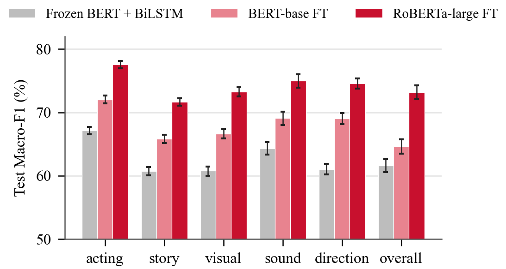

<!-- Ghi chú nội bộ: trên máy làm việc, đọc GHI_NHO.md trước khi làm việc và cập nhật cuối mỗi phiên (file này không được đưa lên GitHub). -->

# imdb-sentiment-revisited: Phân tích cảm xúc review phim IMDb theo khía cạnh

Một review phim hiếm khi chỉ khen hoặc chỉ chê: người xem có thể khen diễn viên nhưng chê kịch bản. Dự án này làm **phân tích cảm xúc theo khía cạnh (ABSA)** trên IMDb. Với mỗi review, mô hình cho biết người viết **khen, chê, trung lập hay không nhắc tới** từng khía cạnh: **diễn xuất, cốt truyện, hình ảnh, âm thanh, đạo diễn và đánh giá chung**.

- IMDb không có nhãn theo khía cạnh, nên nhóm cho **Qwen3-8B chạy ngay trên laptop** gán nhãn cho cả 49.777 review. Không dùng API trả phí.
- Trên nhãn đó, nhóm huấn luyện 3 mô hình. Mô hình tốt nhất là **RoBERTa-large fine-tune: Macro-F1 74,19% ± 0,13** trên 25.000 review test.
- Dự án là bước tiếp theo của phần phân loại 2 lớp: tái lập BERT + BiLSTM của Nkhata *et al.* (2023), rồi cải tiến lên 96,74% (xem [mục 2](#2-kết-quả-phần-1-phân-loại-2-lớp)).

**Nhóm thực hiện:** Trường Đại học FPT, thành phố Đà Nẵng, Việt Nam

| Họ và tên | MSSV |
|---|---|
| Vũ Quốc Đạt | DE200522 |
| Nguyễn Gia Phúc | DE200407 |
| Ngô Ngọc Trường Sơn | DE200399 |

---

## Mục lục

1. [Kết quả chính: ABSA 6 khía cạnh](#1-kết-quả-chính-absa-6-khía-cạnh)
2. [Kết quả phần 1: phân loại 2 lớp](#2-kết-quả-phần-1-phân-loại-2-lớp)
3. [Demo](#3-demo)
4. [Cấu trúc thư mục](#4-cấu-trúc-thư-mục)
5. [Yêu cầu hệ thống và cài đặt](#5-yêu-cầu-hệ-thống-và-cài-đặt)
6. [Chuẩn bị dữ liệu và mô hình](#6-chuẩn-bị-dữ-liệu-và-mô-hình)
7. [Chạy lại phần ABSA](#7-chạy-lại-phần-absa)
8. [Chạy lại phần phân loại 2 lớp](#8-chạy-lại-phần-phân-loại-2-lớp)
9. [Kiểm thử](#9-kiểm-thử)
10. [Báo cáo và tài liệu](#10-báo-cáo-và-tài-liệu)
11. [Nguồn, trích dẫn và license](#11-nguồn-trích-dẫn-và-license)

---

## 1. Kết quả chính: ABSA 6 khía cạnh

| | |
|---|---|
| Khía cạnh | acting (diễn xuất), story (cốt truyện), visual (hình ảnh), sound (âm thanh), direction (đạo diễn), overall (đánh giá chung) |
| Nhãn | positive, negative, neutral, none (không nhắc tới) |
| Dữ liệu | 21.027 train / 3.750 validation / 25.000 test, chia theo phim, giữ nguyên tập test chính thức của IMDb |
| Nhãn huấn luyện | Nhãn silver do Qwen3-8B (lượng tử 4 bit, llama.cpp) gán, có trích câu bằng chứng và kiểm tra bằng chứng |

Kết quả trên **25.000 review test**, so với nhãn silver. Mỗi ô là trung bình ± độ lệch chuẩn qua 3 seed (42, 43, 44):

| Mô hình | Macro-F1 (%) | KTC 95% | Nhận ra khía cạnh (F1) | Cảm xúc (F1) | Overall khớp số sao | Thời gian / seed |
|---|---:|---|---:|---:|---:|---:|
| BERT đóng băng + BiLSTM | 62,58 ± 0,36 | [62,21; 62,94] | 87,71 | 62,26 | 94,6% | 23 phút |
| BERT-base fine-tune | 67,86 ± 0,11 | [67,47; 68,24] | 90,82 | 67,09 | 95,2% | 15 phút |
| **RoBERTa-large fine-tune** | **74,19 ± 0,13** | **[73,81; 74,56]** | **92,09** | **75,01** | **97,5%** | 63 phút |



**Những điểm chính:**

- **Nhãn LLM đủ tốt khi bắt LLM trích bằng chứng trước.** So với 300 review tham chiếu, prompt chỉ hỏi nhãn đạt Cohen's κ trung bình 0,54. Prompt bắt chép nguyên văn câu bằng chứng trước rồi mới ra nhãn đạt 0,72.
- **Mọi chênh lệch đều có ý nghĩa thống kê.** Kiểm định bằng bootstrap ghép cặp theo 3.581 phim (10.000 lần lấy mẫu, hiệu chỉnh Holm). RoBERTa-large hơn BERT-base 6,33 điểm [5,99; 6,66] và hơn BiLSTM 11,61 điểm. Cả 18 so sánh theo từng khía cạnh cũng đều có ý nghĩa.
- **Kiểm tra độc lập với LLM:** số sao do chính người viết review cho. Khi mô hình kết luận overall là khen hoặc chê, kết luận đó khớp với số sao ở 97,5% review. Dự đoán "trung lập" tập trung ở review 4 sao và 7 sao, đúng chỗ người viết hay khen chê lẫn lộn.
- **Chỗ còn yếu.**
  - Lớp neutral: F1 chỉ 35–54%.
  - Review dài hơn 512 token: thấp hơn 8,3 điểm, vì phần giữa bị bỏ.
  - Với hình ảnh, âm thanh và đạo diễn, phần lớn lỗi nằm ở việc nhận ra khía cạnh có được nhắc tới hay không.

  Chi tiết ở `reports/absa_v1/analysis/error_analysis.md`.
- **Giới hạn.** Mọi điểm số đo so với nhãn silver, chưa phải nhãn người. Quy trình và công cụ kiểm tay 400 review test đã có sẵn (`scripts/absa_human_check.py`) nhưng chưa được thực hiện trong thời gian dự án; ngoài phép so với số sao (chỉ cho overall), chưa có số đo độ chính xác so với người.

---

## 2. Kết quả phần 1: phân loại 2 lớp

Macro-F1 trên **25.000 review test chính thức**, trung bình ± độ lệch chuẩn qua 3 seed:

| Cấu hình | Số token | Macro-F1 (%) |
|---|---:|---:|
| Tái lập bài báo, theo mô tả trong bài (BERT đóng băng + BiLSTM) | 128 | 84,97 ± 0,30 |
| Tái lập bài báo, theo mã tác giả (BERT đóng băng + BiLSTM) | 256 | 89,41 ± 0,67 |
| BERT đóng băng + mean pooling | 256 | 85,71 ± 0,04 |
| BERT đóng băng + BiLSTM, lấy phần đầu | 256 | 90,14 ± 0,13 |
| BERT đóng băng + BiLSTM, lấy đầu + cuối | 256 | 91,87 ± 0,17 |
| Fine-tune BERT-base, đầu 128 + cuối 382 | 512 | 94,38 ± 0,17 |
| **Fine-tune RoBERTa-large, đầu 128 + cuối 382** | **512** | **96,74 ± 0,04** |

- **Không so trực tiếp với con số 97,67% của bài báo gốc.** Bài báo đo trên cách chia lại sau khi gộp train và test. Repo này giữ nguyên tập test chính thức.
- **Điểm yếu lớn nhất của cách làm gốc là cắt mất phần cuối review.** Ở giới hạn 256 token, 40% review test bị cắt. Chỉ cần giữ cả đầu lẫn cuối là điểm trên nhóm review bị cắt tăng từ 86,7% lên 90,3%.
- Mọi cải tiến đều có ý nghĩa thống kê (`reports/significance_tests.json`).

Phân loại 2 lớp gần như đã bão hoà, nhưng không cho biết người xem thích hay không thích **điều gì**. Đó là lý do nhóm chuyển sang ABSA.

---

## 3. Demo

Demo web chạy hoàn toàn trên máy, không gửi review ra ngoài. Bạn dán một review tiếng Anh vào, demo hiện nhãn và xác suất cho 6 khía cạnh.

- Kết quả chính lấy từ RoBERTa-large. Ngay dưới là nhãn BERT-base để so sánh.
- Với mỗi mô hình, demo nạp seed có Macro-F1 validation cao nhất, không nhìn tập test.

```bash
run\absa-demo.cmd
```

Mở http://127.0.0.1:8766 sau khi cửa sổ hiện dòng "Sẵn sàng". Nạp 2 mô hình mất khoảng 10–30 giây.

| Tùy chọn | Ý nghĩa |
|---|---|
| CPU (mặc định) | Mỗi review mất dưới 1 giây |
| `run\absa-demo.cmd --device cuda` | Chạy trên GPU |
| `--port` | Đổi cổng |

Demo cần `best.pt` của `absa_roberta_large_v1` và `absa_bert_base_v1` (đường dẫn ghi trong `checkpoint_dir` của config) cùng `work_dirs/<version>/seed*/result.json`.

Demo cũ của phần 2 lớp vẫn còn: `run\run-demo.cmd`, cổng 8765.

---

## 4. Cấu trúc thư mục

```
imdb-sentiment-revisited/
├── configs/
│   ├── absa_labeling_v*.json, absa_prompt_v*.txt   Cấu hình và prompt gán nhãn LLM (bản chính thức: v2 + prompt v3)
│   ├── absa_{bilstm,bert_base,roberta_large}_v1.json   3 mô hình ABSA
│   └── *.json                                       Thí nghiệm phân loại 2 lớp
├── scripts/
│   ├── absa_label_llm.py          ABSA bước 1: gán nhãn silver bằng LLM local (có thể dừng / chạy tiếp)
│   ├── absa_compare_labels.py     ABSA bước 2: so nhãn LLM với bộ tham chiếu (kappa, F1)
│   ├── absa_core.py, train_absa.py ABSA bước 3: mô hình nhiều đầu và huấn luyện
│   ├── absa_significance.py       ABSA bước 4: bootstrap theo phim + Holm
│   ├── absa_error_analysis.py     ABSA bước 5: phân tích lỗi
│   ├── absa_human_check.py        ABSA bước 6: tạo file kiểm tay và chấm điểm
│   ├── absa_demo_server.py        Demo web ABSA
│   ├── prepare_full_imdb.py       Tạo split sạch từ aclImdb_v1.tar.gz (dùng chung)
│   ├── train_reproduction.py, train_baselines.py, train_finetune_headtail.py, significance_tests.py
│   │                              Phân loại 2 lớp
│   ├── demo_server.py, check_demo.py   Demo của phần 2 lớp
│   ├── train_multichunk.py, train_chunk_compare.py, ...   Thí nghiệm phụ (mục 10)
│   ├── diagnostics/               Công cụ chẩn đoán lỗi CUDA
│   └── tests/                     Unit test chạy trên CPU
├── run/                     File .cmd chạy nhanh trên Windows (absa-*.cmd cho phần ABSA)
├── demo_absa/               Giao diện web của demo ABSA
├── demo/                    Giao diện web của demo 2 lớp
├── reports/
│   ├── absa_v1/                   Kết quả ABSA: results.json từng mô hình, significance.json,
│   │                              agreement_qwen_v*.json, analysis/, human_check/, reference/
│   ├── ieee_paper_absa/           Bài báo IEEE về ABSA (LaTeX + PDF + script vẽ hình)
│   ├── ieee_paper/                Bài báo IEEE về phân loại 2 lớp
│   └── ...                        Báo cáo, hình, kiểm định của phần 2 lớp
├── docs/                    absa_proposal.md (lý do và thiết kế), absa_run.md (cách chạy), tài liệu phần 2 lớp
├── requirements-*.txt
├── THIRD_PARTY_NOTICES.md   Nguồn gốc và license của dữ liệu, mô hình, mã bên thứ ba
└── LICENSE                  MIT (chỉ áp dụng cho mã của nhóm)
```

**Không có trên GitHub**, vì quá nặng hoặc chịu license của bên thứ ba:

- `data/`, gồm cả nhãn silver
- `checkpoints/`, `work_dirs/`, `logs/`, `third_party/`
- 3 file Excel kiểm tay, vì chứa toàn văn review. Tạo lại được bằng `absa_human_check.py prepare`.

---

## 5. Yêu cầu hệ thống và cài đặt

| Thành phần | Đã dùng khi chạy thí nghiệm |
|---|---|
| Hệ điều hành | Windows 11 (các lệnh Python cũng chạy được trên Linux) |
| GPU | NVIDIA RTX 5070 Laptop, 8 GB VRAM, CUDA 12.8 |
| Python | 3.9 trở lên |
| Thư viện chính | PyTorch 2.7.1, Transformers 4.51.3, scikit-learn 1.6.1, NumPy 1.26.4 |
| Gán nhãn LLM | llama.cpp b12081 (bản CUDA cho Windows) + `Qwen3-8B-Q4_K_M.gguf` (5 GB), cần khoảng 6,5 GB VRAM |
| Dung lượng trống | Khoảng 25 GB cho phần 2 lớp. Thêm khoảng 20 GB cho checkpoint ABSA: RoBERTa-large khoảng 1,4 GB mỗi seed nếu chỉ giữ `best.pt` |

Các lệnh dưới đây chạy trong PowerShell hoặc Command Prompt, từ thư mục gốc của repo.

```bash
git clone https://github.com/sotbatchien123/imdb-sentiment-revisited.git
cd imdb-sentiment-revisited

python -m venv .venv-train
.venv-train\Scripts\python -m pip install --upgrade pip
.venv-train\Scripts\python -m pip install torch==2.7.1 --index-url https://download.pytorch.org/whl/cu128
.venv-train\Scripts\python -m pip install -r requirements-train.txt
```

- Muốn cài đúng từng phiên bản đã dùng thì thay `requirements-train.txt` bằng `requirements-train.lock.txt`.
- Vẽ hình cần thêm `matplotlib`. Script kiểm tay cần thêm `openpyxl`. Hai thư viện này có sẵn trong Anaconda, hoặc cài vào venv bằng `pip install matplotlib openpyxl`.

---

## 6. Chuẩn bị dữ liệu và mô hình

### 6.1. Dữ liệu IMDb

1. Tải `aclImdb_v1.tar.gz` từ https://ai.stanford.edu/~amaas/data/sentiment/ và đặt vào `data/raw/` (không cần giải nén).
2. Tạo split sạch:

```bash
.venv-train\Scripts\python scripts\prepare_full_imdb.py
```

Script làm 3 việc:
- loại 223 review train bị trùng lặp, hoặc trùng với tập test;
- chia phần còn lại **theo phim** thành 21.027 review train và 3.750 review validation;
- giữ nguyên 25.000 review test.

Kết quả nằm ở `data/processed/imdb_full_v1/`. File `manifest.json` trong đó ghi mã SHA-256 của file nguồn và danh sách review bị loại.

### 6.2. Mô hình tiền huấn luyện

```bash
.venv-train\Scripts\huggingface-cli download google-bert/bert-base-uncased --local-dir checkpoints/bert-base-uncased
.venv-train\Scripts\huggingface-cli download FacebookAI/roberta-large --local-dir checkpoints/roberta-large
```

### 6.3. LLM để gán nhãn (chỉ cần nếu muốn gán lại)

- llama.cpp: tải bản build Windows CUDA tại https://github.com/ggml-org/llama.cpp/releases.
- Qwen3-8B: tải `Qwen3-8B-Q4_K_M.gguf` tại https://huggingface.co/Qwen/Qwen3-8B-GGUF.
- Đường dẫn đặt trong `run/absa-llm-server.cmd` (biến `LLAMA_DIR`). Chi tiết ở `docs/absa_run.md`, mục 0.

---

## 7. Chạy lại phần ABSA

Hướng dẫn đầy đủ: [docs/absa_run.md](docs/absa_run.md). Tóm tắt:

| Bước | Lệnh | Thời gian (RTX 5070 Laptop) |
|---|---|---|
| 1. Mở server LLM | `run\absa-llm-server.cmd` (giữ cửa sổ này mở) | — |
| 2. Gán nhãn silver | `run\absa-label.cmd` | ~21 giờ cho 49.777 review |
| 3. So nhãn với bộ tham chiếu | `scripts\absa_compare_labels.py ...` (xem docs) | vài giây |
| 4. Huấn luyện 3 mô hình × 3 seed | `run\absa-train.cmd` | ~5 giờ |
| 5. Kiểm định | `.venv-train\Scripts\python scripts\absa_significance.py` | ~5 phút, CPU |
| 6. Phân tích lỗi | `.venv-train\Scripts\python scripts\absa_error_analysis.py` | ~1 phút, CPU |
| 7. Kiểm tay (chưa thực hiện) | `python scripts\absa_human_check.py prepare`, gán xong thì chạy `... score` | ~3–4 giờ / người |
| 8. Hình cho bài báo | `python reports\ieee_paper_absa\make_figures.py` | vài giây |

- **Gán nhãn và huấn luyện đều chạy tiếp được.** Dừng bằng Ctrl+C, hoặc tạo file `work_dirs/<version>/PAUSE`. Chạy lại đúng lệnh cũ thì script bỏ qua phần đã xong.
- **Đừng chạy server LLM cùng lúc với huấn luyện.** Card 8 GB không đủ cho cả hai. Trên Windows, khi tràn VRAM chương trình không báo lỗi mà chậm đi hàng chục lần.
- **Quy tắc đánh giá:**
  - chọn epoch theo Macro-F1 validation;
  - tập test chỉ chạy một lần cho mỗi seed;
  - không dò gì trên test.

---

## 8. Chạy lại phần phân loại 2 lớp

| Bước | Lệnh | Thời gian / seed |
|---|---|---|
| Tái lập bài báo | `.venv-train\Scripts\python scripts\train_reproduction.py` | ~20–30 phút / biến thể |
| Baseline BERT đóng băng | `.venv-train\Scripts\python scripts\train_baselines.py --config configs/full_imdb.json` | 1–8 giờ / lượt |
| Fine-tune BERT-base | `.venv-train\Scripts\python scripts\train_finetune_headtail.py` | ~20–40 phút |
| Fine-tune RoBERTa-large | `.venv-train\Scripts\python scripts\train_finetune_headtail.py --config configs\finetune_roberta_large_v1.json` | ~1–1,5 giờ |
| Kiểm định | `.venv-train\Scripts\python scripts\significance_tests.py` | ~30 giây |

Mọi script có `--smoke` để chạy thử nhanh. Có thể chạy riêng một seed bằng `--seed 43`. Chi tiết ở `reports/ieee_paper/README.md` và các file trong `docs/`.

---

## 9. Kiểm thử

```bash
.venv-train\Scripts\python -m unittest discover -s scripts\tests -v
```

Có 46 test, chạy trên CPU trong khoảng 5 giây. Các test kiểm tra:

| Nhóm | Nội dung |
|---|---|
| ABSA | Đọc kết quả của LLM, kiểm tra bằng chứng, chạy tiếp sau khi dừng |
| ABSA | Mô hình nhiều đầu, trọng số lớp, độ đo |
| ABSA | Huấn luyện một mô hình tí hon từ đầu đến cuối trên CPU |
| ABSA | Bootstrap và Holm, kappa, chọn mẫu kiểm tay |
| ABSA | Chọn seed của demo |
| Phần 2 lớp | Cắt đầu–cuối, ghi trạng thái an toàn, mô-đun nhiều đoạn |

---

## 10. Báo cáo và tài liệu

| File | Nội dung |
|---|---|
| `reports/ieee_paper_absa/main.pdf` | Bài báo IEEE về ABSA (tiếng Anh, 6 trang) |
| `reports/BAO_CAO_ABSA_2026-11-09.docx` (+ `.pdf`) | Báo cáo tiếng Việt về phần ABSA (13 trang) |
| `notebooks/ABSA_MovieReview.ipynb` | Notebook trình bày dữ liệu, nhãn LLM, kết quả, kiểm định, phân tích lỗi (chạy được không cần GPU) |
| `reports/absa_v1/significance.json` | Khoảng tin cậy và kiểm định cho 3 mô hình |
| `reports/absa_v1/analysis/error_analysis.md` | Phân tích lỗi ABSA |
| `reports/absa_v1/human_check/HUONG_DAN.md` | Hướng dẫn kiểm tay (quy trình đã chuẩn bị, chưa thực hiện) |
| `docs/absa_proposal.md`, `docs/absa_run.md` | Thiết kế và cách chạy phần ABSA |
| `reports/ieee_paper/main.pdf` | Bài báo IEEE về phân loại 2 lớp |
| `reports/BAO_CAO_CAI_TIEN_2026-11-01.docx` | Báo cáo tiếng Việt của phần 2 lớp |
| `docs/code_audit.md` | Đối chiếu mã của tác giả bài gốc với mô tả trong bài |

**Thí nghiệm phụ.** Những thí nghiệm sau không dùng cho kết quả chính, nhưng vẫn giữ lại để minh bạch:

| Thí nghiệm | Tình trạng |
|---|---|
| Baseline trên tập con phim Horror | Đã dừng |
| Đọc review dài theo nhiều đoạn | Dừng do lỗi driver GPU |
| Gộp đoạn bằng attention | Có mã, chưa chạy |
| Dịch review sang tiếng Việt bằng NLLB | Có công cụ, chưa dịch |

---

## 11. Nguồn, trích dẫn và license

- **Dữ liệu:** A. L. Maas *et al.*, *Learning Word Vectors for Sentiment Analysis*, ACL 2011.
- **Bài báo tái lập (phần 1):** G. Nkhata, S. Gauch, U. Anjum, J. Zhan, *Fine-tuning BERT with Bidirectional LSTM for Fine-grained Movie Reviews Sentiment Analysis*, 2023 (arXiv:2502.20682).
- **Mô hình:**
  - `google-bert/bert-base-uncased` (Apache-2.0)
  - `FacebookAI/roberta-large` (MIT)
  - `Qwen/Qwen3-8B` (Apache-2.0)
  - llama.cpp (MIT)

Mã do nhóm viết trong repo này phát hành theo giấy phép **MIT** (xem [LICENSE](LICENSE)). Giấy phép này **không** áp dụng cho dữ liệu, mô hình và mã của bên thứ ba. Một số thành phần đó chỉ được dùng cho mục đích phi thương mại. Chi tiết xem [THIRD_PARTY_NOTICES.md](THIRD_PARTY_NOTICES.md).
